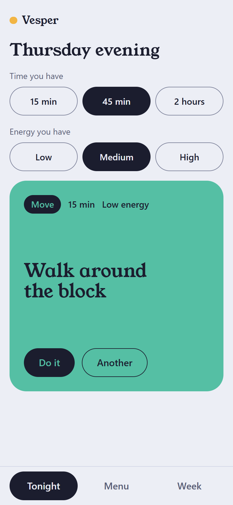
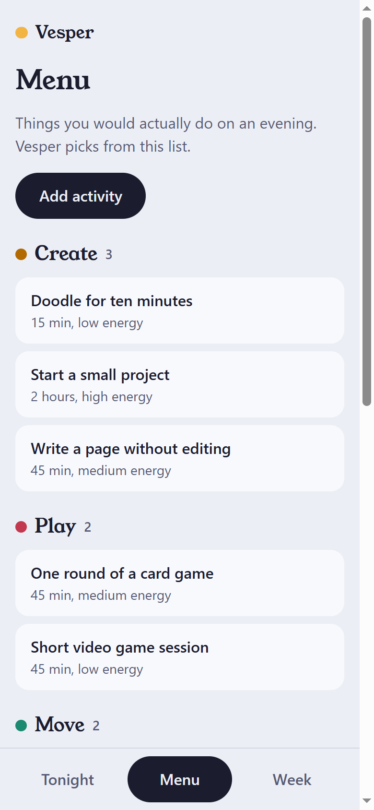
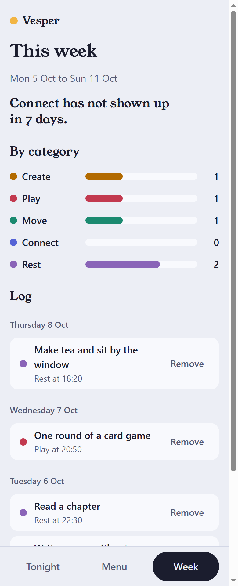
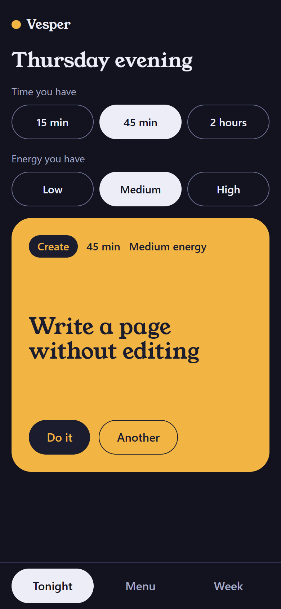
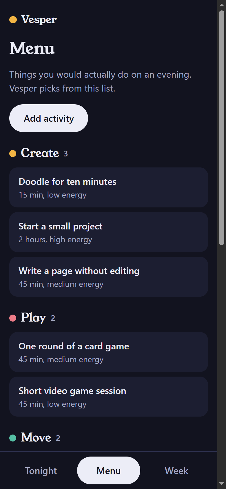
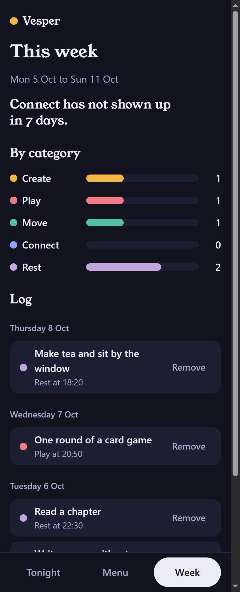

# Vesper

**One thing for tonight.**

Some evenings the hard part is not doing something, it is deciding what. Vesper keeps your own short menu of things you would actually do, asks how much time and energy you have, and picks one. Do it, mark it done, and at the end of the week see which part of your life you have been skipping.

Plain HTML, CSS and JavaScript. No framework, no build step, no dependencies, no account, no server. Your data never leaves your browser.

**Live demo:** https://francesco-mauro.github.io/vesper/

<p>
  
  
  
</p>
<p>
  
  
  
</p>

## Contents

- [How it works](#how-it-works)
- [How the pick is made](#how-the-pick-is-made)
- [Your data](#your-data)
- [Run it locally](#run-it-locally)
- [Deploy to GitHub Pages](#deploy-to-github-pages)
- [Install it on a phone](#install-it-on-a-phone)
- [Project layout](#project-layout)
- [Design decisions](#design-decisions)
- [Browser support](#browser-support)
- [License](#license)

## How it works

- **Tonight.** Choose how long you have (15 minutes, 45 minutes, 2 hours) and how much energy (low, medium, high). Vesper shows one activity. *Another* shows a different one and never repeats until you have seen everything that fits. *Do it* starts it, *Mark done* logs it.
- **Menu.** Your list. Each activity has a name, one of five categories (Create, Play, Move, Connect, Rest), the time it takes and the energy it needs. A first run starts with a generic sample menu you can edit freely.
- **Week.** The current Monday to Sunday week: a bar per category, one calm sentence about balance, and a log grouped by day.

## How the pick is made

An activity is a candidate when it fits inside the time and energy you chose. One candidate is drawn at random, in proportion to a weight:

```
weight = 1 / (1 + done in this category over the last 7 days)
       / number of candidates in the category
       x 0.2 if it was the last thing you did
       x 2   if its time matches your choice exactly
       x 2   if its energy matches your choice exactly
```

Categories you have skipped lately are favoured, a crowded category does not win just by being big, and "2 hours, high energy" does not end up suggesting only 15 minute things. The weight is never zero, so there is always something to draw. The code is in [`src/picker.js`](src/picker.js): a pure function that takes data and a random function.

Two details worth knowing:

- The day rolls over at **4 in the morning**, so finishing something at 00:30 still counts for the evening that started before midnight.
- The pick looks at the **last 7 rolling days**, while the Week screen shows the **calendar week**. On a Monday morning the Week screen is empty but the pick still remembers the weekend.

## Your data

Everything is stored in `localStorage` under one key, `vesper.state`. Nothing is sent anywhere.

- **Export** downloads a JSON file. **Import** replaces your data with a file, after showing you what will be replaced.
- Imports are validated strictly: size, counts, every field, real calendar dates, timestamps that match their day, unique ids. A bad file is rejected with the reason (for example "Activity 3: the title must be 1 to 60 characters") and changes nothing. Titles are only ever rendered as text.
- If saved data cannot be read, Vesper starts with the sample menu and keeps a copy of the unreadable data under `vesper.state.corrupt` (the one before it moves to `vesper.state.corrupt.prev`). The banner has a **Download** button for it.
- If the data comes from a newer version of the app, it is shown but never overwritten: import and reset are switched off until you reload.
- If the browser blocks storage or it is full, a banner says so and what to do.
- Two open tabs stay in sync, and a page that comes back from the background re-reads storage and the clock.
- The log keeps the most recent 5,000 entries; older ones drop off.

## Run it locally

ES modules do not load from `file://`, so serve the folder. Any static server works:

```
npx serve .
```

or the VS Code *Live Server* extension, or `python -m http.server 8123` and then http://localhost:8123. Python's built-in server has a very small connection queue, so now and then it refuses one of the many files a browser asks for at once (an `ERR_CONNECTION_REFUSED` and a blank page). If that happens, reload.

The service worker is not registered on localhost unless you add `?sw` to the address. Once registered it stays active and serves cached files first, so your edits show one reload late, and it can answer for other projects you later serve on the same port. Visit `http://localhost:8123/?sw=off` to remove Vesper's worker and its caches, or unregister it in DevTools (Application, Service Workers).

## Deploy to GitHub Pages

Settings, Pages, *Deploy from a branch*, branch `main`, folder `/ (root)`. All paths are relative, so it works from the `/vesper/` sub-path. `.nojekyll` is included so files are served as they are.

## Install it on a phone

- **Android (Chrome):** menu, *Install app*.
- **iPhone (Safari):** Share, *Add to Home Screen*.

Once installed it works offline. All app files update together or not at all: after each visit the service worker fetches a fresh copy of every file and replaces the cache only if every download succeeded, so you never get a mix of old and new. A new version therefore shows up on the visit after the one that downloaded it. On iPhone an installed app has storage separate from Safari, so move your data with Export and Import.

## Project layout

```
index.html              page shell, CSP, meta tags
manifest.webmanifest    install metadata
sw.js                   offline cache, refreshed all files at once
styles/tokens.css       colours, type, space, shape
styles/app.css          layout and components
src/main.js             hash routing, storage banner, service worker registration
src/state.js            the one source of truth and its actions
src/storage.js          localStorage, export, import
src/schema.js           data shapes and the single validator
src/picker.js           the weighted pick
src/stats.js            week counts and the balance sentence
src/dates.js            day keys, weeks, formatting
src/seed.js             the sample menu
src/dom.js              element helper, dialogs, focus and announcements
src/views/              tonight.js, menu.js, week.js
```

## Design decisions

- **No dependencies.** About 1,800 lines of JavaScript and 800 of CSS, small enough to read in a sitting.
- **State is never mutated.** Each action builds a new state, saves it and notifies the view. Views are functions that rebuild their DOM.
- **One validator.** Data loaded from `localStorage` and data imported from a file go through the same checks, and objects are rebuilt field by field from a whitelist.
- **Content Security Policy.** Set in `index.html`: scripts and styles only from this origin, no inline code, no `innerHTML`.
- **Dates are local.** Day keys are built from local calendar fields and day arithmetic goes through `Date.UTC`, so daylight saving changes cannot move a date.
- **Accessible by default.** Native `<dialog>`, radio groups for the choosers, a single live region for announcements, visible focus, 44px targets, focus moved to the new heading on navigation and back to the button that opened a dialog, `prefers-reduced-motion` and `prefers-color-scheme` respected.
- **Colour is never the only signal.** Every category dot sits next to its name, and bars show their number.
- **Type.** Titles use [Young Serif](https://github.com/noirblancrouge/YoungSerif) (SIL Open Font License, bundled in `assets/fonts`), the rest uses the system font.

## Browser support

Built and tested in Chromium (Chrome, Edge). It sticks to features current Firefox and Safari 15.4 or later support (ES modules, native `<dialog>`, `:focus-visible`, `dvh`), but it has not been tested there or on a real iPhone yet.

## License

[MIT](LICENSE). The bundled typeface keeps its own license, see [`assets/fonts/OFL.txt`](assets/fonts/OFL.txt).
